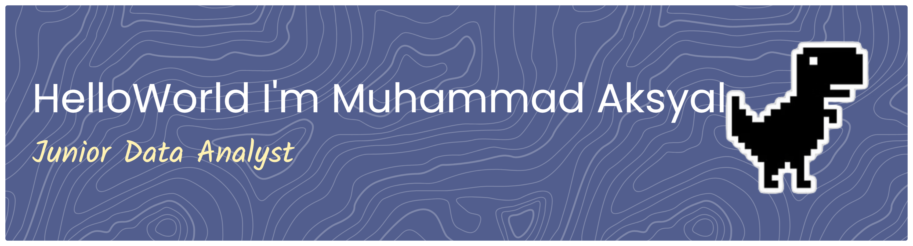

<div align="center">
<h3>✦ Data Analyst ✦</h3>

_Mengubah angka menjadi cerita, dan cerita menjadi keputusan._

<br>

───────────────────────────────────────

</div>

<br>

<div align="center">

## 🌌 Tentang Saya

</div>

> 📍 Indonesia  
> 🔍 Mencari pola di balik data  
> 📐 Membangun dashboard yang bisa dipahami siapa pun  
> 🧭 Membantu tim mengambil keputusan yang lebih tepat

<br>

<div align="center">

## 🎨 Keahlian Visual

</div>

```
 DATA          ANALISIS         VISUALISASI        ALAT BANTU
 ─────         ─────────        ───────────        ──────────
 ◆ SQL         ◆ Statistik      ◆ Power BI         ◆ Git
 ◆ Python      ◆ A/B Testing    ◆ Tableau          ◆ Colab
 ◆ Excel       ◆ Forecasting    ◆ Looker Studio    ◆ BigQuery
 ◆ Pandas      ◆ Segmentasi     ◆ Matplotlib       ◆ Notion
```

<br>

<div align="center">

<div align="center">

## 🪐 Proyek Pilihan

</div>

<div align="center">

| 📁 Proyek | 📝 Deskripsi | 🛠️ Tools |
|:--:|:--|:--|
| 🛒 **Sales Dashboard** | Memantau KPI dan tren revenue | Power BI · SQL |
| 👥 **Customer Segmentation** | Mengelompokkan pelanggan berdasarkan perilaku | Python · Pandas |
| 📉 **Churn Analysis** | Menemukan akar penyebab pelanggan berhenti | Python · Scikit-learn |
| 🧪 **A/B Test Evaluation** | Menguji hipotesis dengan keyakinan statistik | Python · SciPy |

</div>

<div align="center">

## ✉️ Mari Terhubung

────────────────────────────────

[](https://[website-kamu].com) &nbsp;·&nbsp; [](https://linkedin.com/in/muhammad-aksyal) &nbsp;·&nbsp; [](mailto:aksyalnizam01@gmail.com)

────────────────────────────────

<br>

_"Di balik setiap angka ada cerita yang menunggu untuk ditemukan."_

<br>

</div>
